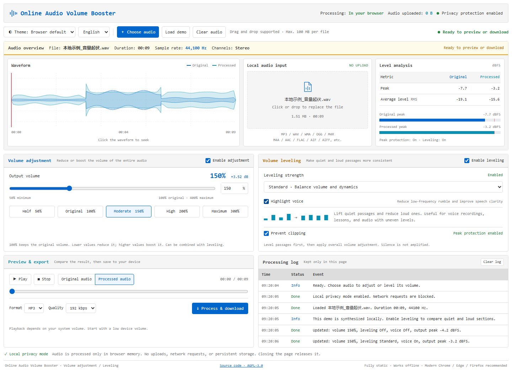
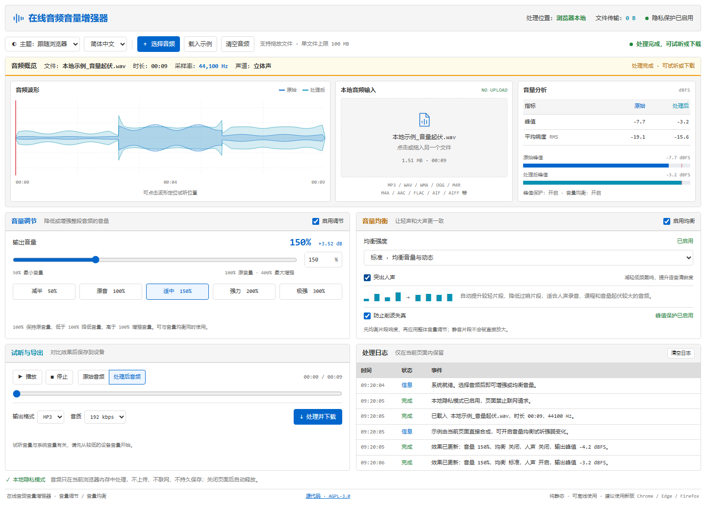
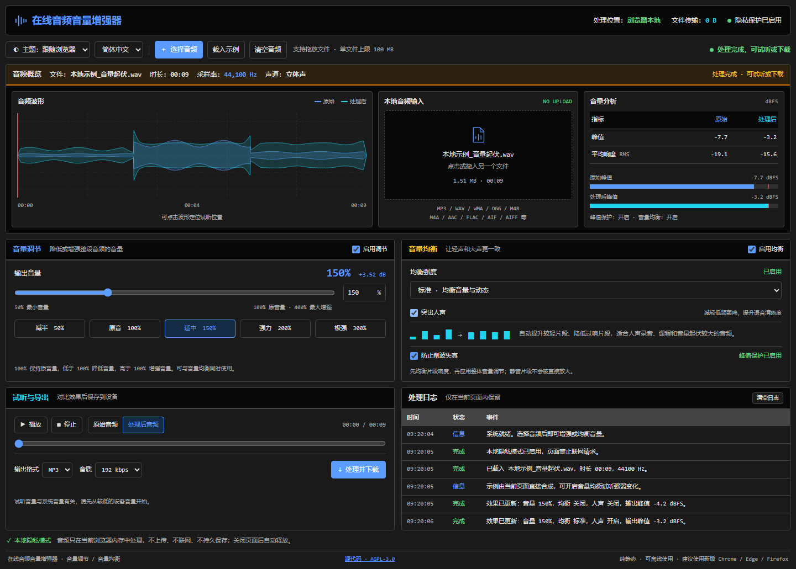

# Online Audio Volume Booster

[简体中文](README.md) | [English](README.en.md)

Reduce, boost, or level audio volume locally in your browser. No installation or uploads required. Works offline.

## Screenshots



<details>
<summary>View the Chinese interface in light and dark modes</summary>





</details>

## Features

- **Volume adjustment**: 50%–400%, with Half, Original, Moderate, High, and Maximum presets. 100% preserves the original volume; 50% halves the signal amplitude.
- **Volume leveling**: Gentle, Standard, and Strong settings lift quieter passages and reduce louder ones. Can be combined with overall volume adjustment.
- **Highlight voice**: An independent option that reduces low-frequency rumble and muddiness while improving speech clarity. Can be combined with leveling.
- **Peak protection**: Enabled by default to reduce clipping distortion.
- **Local preview**: Compare original and processed audio, pause or seek, and inspect the waveform, peak level, and average RMS level.
- **Export**: MP3 at 128 / 192 / 320 kbps, or WAV with 16-bit / 24-bit PCM.
- **English and Chinese interfaces**: The first visit uses the browser's preferred languages. Manual language selections are remembered.
- **Light and dark themes**: Follows the browser's preference and updates automatically when it changes. Manual selection is also available.

## Usage

Download the repository or archive, then open **`index.html`** in a modern version of Chrome, Edge, or Firefox. You can also deploy it to any static website hosting service.

All styles, scripts, encoders, and format decoders are embedded in the page. There is no need to start a local server or download additional dependencies. **Load demo** synthesizes an audio example directly in the page for previewing.

### Supported input formats

MP3, WAV, WMA, OGG, M4R, M4A, AAC, FLAC, and AIF / AIFF, plus common formats such as OPUS, APE, AC3, AMR, and WebM.

The tool first tries native browser decoding. Unsupported formats automatically use the embedded, single-thread FFmpeg WebAssembly decoder, which does not require SharedArrayBuffer or a server. Damaged, encrypted, or DRM-protected files may not be readable. Multichannel audio is mixed down to stereo.

The input file limit is 100 MB, and the decoded PCM data limit is 384 MB. Sample rates outside the MP3 encoder's supported range are converted to 44.1 kHz when exporting MP3. Leveling uses dynamic RMS level adjustment; it is not LUFS mastering normalization.

**Highlight voice** uses high-pass and equalization filters to improve speech clarity in voice recordings, lessons, and meetings. It does not perform vocal separation or backing-track removal.

## Privacy and offline use

Audio is processed only in browser memory. It is not uploaded, written to a server, or saved in persistent browser storage. Closing the page releases the audio; only theme and language preferences are saved locally.

The page blocks network requests using `connect-src 'none'`. It does not use CDNs, remote fonts, analytics, or external APIs. The complete embedded decoder makes the standalone HTML file approximately 42 MB.

## Building from source

Requires Node.js. Run the following from the repository root:

```sh
node source/build.cjs
```

The script regenerates `index.html` by default. You can also specify an output path:

```sh
node source/build.cjs index.html
```

The build reuses the FFmpeg binary embedded in the existing `index.html`, so keep that file available. Alternatively, place the matching decoder binary at `source/vendor/ffmpeg-core.wasm`.

## License

Original application code is licensed under the **GNU Affero General Public License v3.0 (AGPL-3.0-only)**. See [LICENSE](LICENSE). When offering a modified version to users over a network, provide its corresponding source code to those users as required by the AGPL.

Third-party FFmpeg and lamejs / LAME components retain their own licenses and are distributed without modifications. Versions, source links, and license texts are listed in [THIRD_PARTY_NOTICES.md](THIRD_PARTY_NOTICES.md) and [licenses/](licenses/).

## Disclaimer

This project is intended for audio volume adjustment, volume leveling, and speech clarity enhancement. Users should process only audio they own or are lawfully authorized to use, and are responsible for ensuring that its use, modification, export, distribution, and subsequent processing comply with applicable laws, relevant agreements, and the scope of the rights holder's authorization. This project does not grant additional permission to reproduce, adapt, or distribute other people's works, use another person's voice, or process another person's personal information.

This project is provided **"as is."** To the extent permitted by applicable law, the authors and contributors make no express or implied warranties, including warranties of merchantability, fitness for a particular purpose, or non-infringement. They do not guarantee that the software is free of defects, compatible with every format or device, or capable of achieving any particular loudness, audio quality, or voice enhancement result. Volume leveling and **Highlight voice** may change the original dynamics and timbre; they are not substitutes for professional mastering, vocal separation, or comprehensive noise removal.

Users and deployers are responsible for assessing and accepting the risks of processing, configuring, operating, and maintaining the project. These include audio distortion, clipping, changes to audio quality or metadata, inability to read or export files, resource exhaustion, an unresponsive browser, data loss, and effects on devices, hearing, or other operations. Keep the original files and preview processed audio at a low device volume. To the maximum extent permitted by applicable law, the authors and contributors are not liable for losses arising from the use, modification, distribution, deployment, or inability to use this project. Liability that cannot lawfully be excluded or limited remains unaffected.

Third-party code, audio materials, and services remain subject to their original licenses and terms of use. This project does not guarantee their availability, accuracy, or security. Modified versions, derivative projects, and third-party hosting services are the responsibility of their respective providers and must not be represented as endorsed or warranted by the original authors.

When using, modifying, distributing, or providing a modified version as a network service, comply with the applicable requirements of the GNU AGPLv3. These include retaining relevant notices, providing corresponding source code, and, where applicable, offering users who interact remotely an opportunity to obtain the corresponding source code of the modified version. This statement adds no restrictions beyond the license and does not reduce the rights it grants. Licensing, warranty, and liability terms are governed by the license and applicable law.

## Privacy notice

This project does not include telemetry, behavioral analytics, advertising, or centralized reporting to the authors. It does not automatically upload selected audio, audio content, file names, processing logs, or exported files to the authors or third parties. Audio processing does not depend on a server, requires no account, and does not request microphone or recording permissions.

Selected audio is read through the browser's local file interface. Decoding, volume adjustment, leveling, voice enhancement, and encoding run in memory in the current page and its local processing workers. Formats that native browser decoding cannot handle use the embedded FFmpeg WebAssembly decoder. Its virtual file system resides in memory, rather than on an author's or deployer's server. Exported files are saved to the user's device through the browser's download function; their destination, download history, and related behavior depend on the browser and the user's settings.

The project does not write audio or page processing logs to persistent browser storage. **Clear audio** releases the page's references to the current audio and export. Processing logs can be removed separately with **Clear log**. Closing the page terminates processing workers and releases page resources. Releasing memory is not secure erasure. The project cannot control operating system swap space, browser caches, crash recovery, extensions, device backups, or files already downloaded. Users are responsible for protecting their devices and managing original files, downloads, and any backups.

The current page does not automatically make external API requests. All required styles, scripts, the MP3 encoder, and format decoders are included in a single HTML file. Its content security policy uses `connect-src 'none'` to block network connections from the page and its processing workers. Browser language and color-scheme preferences are read through local browser APIs. Only manually selected language and theme preferences are stored in browser `localStorage`; they are not used for cross-site tracking. The project does not set session cookies.

Opening the local HTML file requires no network connection. When the page is hosted on a static website, the browser must request it from that website. Hosting platforms, reverse proxies, or their logging systems may therefore receive the visitor's public IP address, request time, and ordinary HTTP request information. The default page does not upload audio with these requests. Following an external link such as **Source code** opens GitHub or the relevant site, which can receive ordinary visit information and is governed by its own privacy policies. This notice describes the default behavior of the current repository code. Modified versions, browser extensions, or third-party deployments may behave differently.
