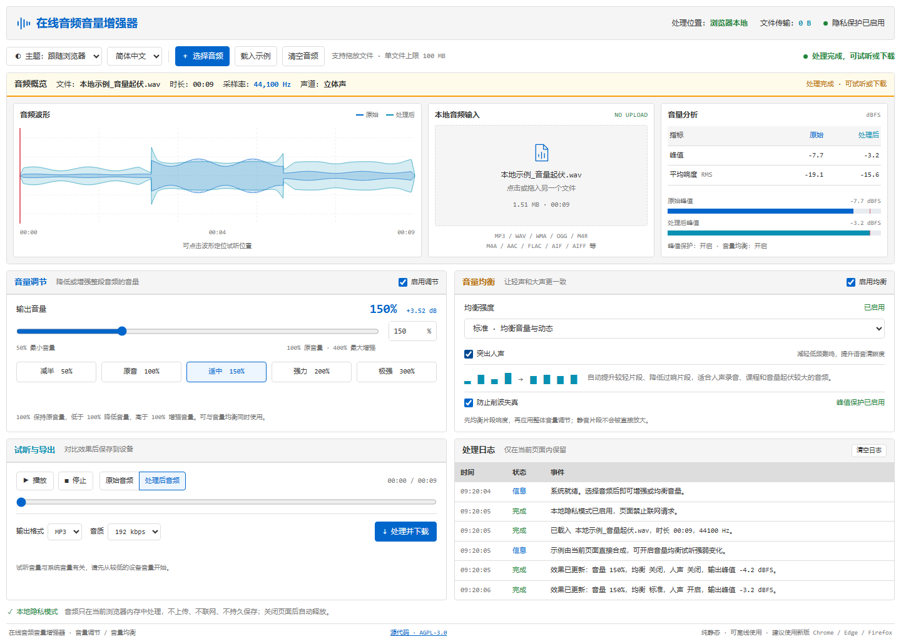
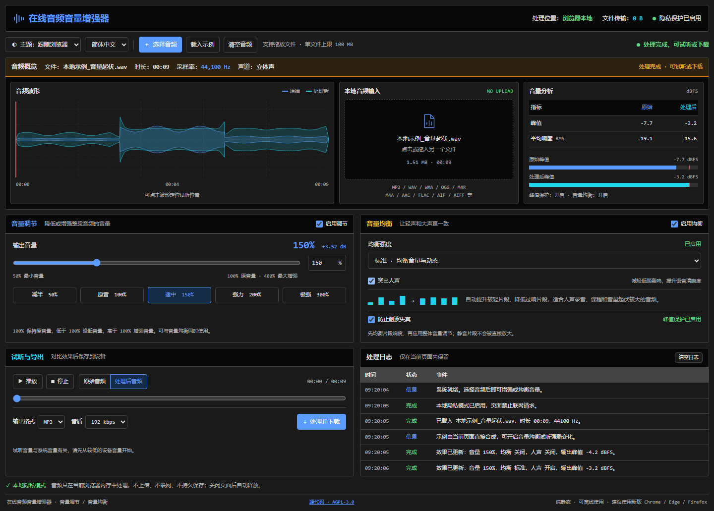
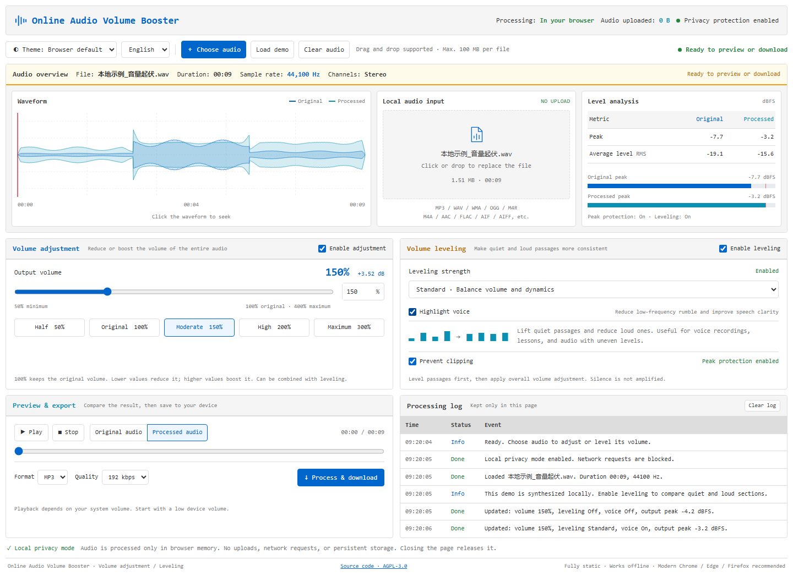

# 在线音频音量增强器

在浏览器本地降低、增强或均衡音频音量。无需安装、无需上传，断网也能使用。

## 页面预览



<details>
<summary>查看深色界面和英文界面</summary>





</details>

## 功能

- **音量调节**：50%–400%，提供减半、原音、适中、强力和极强预设。100% 保持原音量，50% 将信号幅度减半。
- **音量均衡**：轻柔、标准、明显三档，提升较轻片段并降低过响片段，可与音量调节叠加。
- **突出人声**：独立开关，减轻低频轰鸣、减少浑浊感并提升语音清晰度，可与均衡叠加使用。
- **峰值保护**：默认开启，减少削波失真。
- **本地试听**：对比原始与处理后的音频，支持暂停和定位，显示波形、峰值及 RMS 平均电平。
- **导出**：MP3（128 / 192 / 320 kbps）、WAV（16-bit / 24-bit PCM）。
- **中英文界面**：首次按浏览器首选语言匹配，手动选择后记住偏好。
- **明暗主题**：默认跟随浏览器，偏好变化时自动更新，也可手动选择。

English: A fully local audio volume tool with 50%–400% gain, automatic volume leveling, voice enhancement, clipping protection, waveform preview, and MP3/WAV export. Includes English/Chinese interfaces and automatic light/dark themes.

## 使用

下载仓库或压缩包后，使用新版 Chrome、Edge 或 Firefox 打开根目录的 **`index.html`**。也可以部署到任意静态网站托管服务。

网页已经内嵌全部样式、脚本、编码器和格式解码器，不需要启动本地服务器或额外下载依赖。“载入示例”会直接在页面内合成音频，便于试听。

### 支持的输入格式

MP3、WAV、WMA、OGG、M4R、M4A、AAC、FLAC、AIF / AIFF，并兼容 OPUS、APE、AC3、AMR、WebM 等常见格式。

优先使用浏览器原生解码；不支持的格式自动切换至内嵌的单线程 FFmpeg WebAssembly 解码器，不依赖 SharedArrayBuffer 或服务器。损坏、加密或受 DRM 保护的文件无法保证读取，多声道音频会混合为立体声。

单个输入文件上限 100 MB，解码后的 PCM 数据上限 384 MB。高于 MP3 支持范围的采样率会在导出 MP3 时转换为 44.1 kHz。均衡使用动态 RMS 电平调整，并非 LUFS 母带标准化。

“突出人声”通过高通及均衡滤波改善语音清晰度，适合讲话、课程和会议录音；它不进行人声分离或伴奏去除。

## 隐私与离线

音频只在当前浏览器内存中处理，不上传、不写入服务器，也不保存到浏览器持久存储。关闭页面后释放音频；仅主题和语言偏好保存在本机。

页面通过 `connect-src 'none'` 禁止联网请求，不使用 CDN、远程字体、统计代码或外部 API。由于完整内嵌本地解码器，单文件网页约 42 MB。

## 从源码构建

需要 Node.js。在仓库根目录执行：

```sh
node source/build.cjs
```

脚本默认重新生成 `index.html`，也可传入输出路径：

```sh
node source/build.cjs index.html
```

构建时会复用现有 `index.html` 中的 FFmpeg 二进制，因此请保留该文件。也可以自行在 `source/vendor/ffmpeg-core.wasm` 提供对应版本的解码器。

## 许可证

本项目原创源码采用 **GNU Affero General Public License v3.0（AGPL-3.0-only）**，详见 [LICENSE](LICENSE)。修改版本通过网络向用户提供服务时，应依照 AGPL 向这些用户提供相应源代码。

第三方 FFmpeg 和 lamejs / LAME 保留各自许可证，未进行修改。版本、源码地址及许可证见 [THIRD_PARTY_NOTICES.md](THIRD_PARTY_NOTICES.md) 和 [licenses/](licenses/)。

## 免责声明

本项目用于音频音量调节、音量均衡和语音清晰度改善。使用者应仅处理自己拥有或获得合法授权的音频，并自行确认使用、修改、导出、传播及后续处理符合适用法律、相关协议和权利人的授权范围。本项目不授予复制、改编、传播他人作品，使用他人声音或处理他人个人信息的额外授权。

本项目按“现状”提供。在适用法律允许的范围内，作者和贡献者不作任何明示或默示担保，包括适销性、特定用途适用性及不侵权担保，也不保证软件没有缺陷、兼容所有格式和设备，或达到特定响度、音质与人声突出效果。音量均衡和“突出人声”可能改变原始动态及音色，不等同于专业母带处理、人声分离或完整的噪声消除。

使用者及部署者应自行评估并承担处理、配置、运行与维护风险，包括音频失真、削波、音质或元数据变化、文件无法读取或导出、资源耗尽、浏览器无响应、数据丢失，以及对设备、听力或其他业务造成的影响。建议保留原始文件，并以较低的设备音量试听处理结果。在适用法律允许的最大范围内，作者和贡献者不对因使用、修改、分发、部署或无法使用本项目而产生的损失承担责任；依法不能排除或限制的责任不在此限。

第三方代码、音频素材和服务分别受其原始许可及使用条款约束，其可用性、准确性与安全性不由本项目保证。修改版、衍生项目及第三方提供的托管服务由其提供者自行负责，不应被表述为获得原作者认可或担保。

使用、修改、分发或通过网络提供修改版服务时，应遵守 GNU AGPLv3 的适用要求，包括保留相关声明、提供对应源代码，以及在适用情形下向远程交互用户提供获取修改版对应源代码的机会。本说明不增加许可证之外的使用限制，也不削减许可证授予的权利；许可、担保与责任条款以许可证及适用法律为准。

## 隐私说明

本项目未内置遥测、行为分析、广告或向作者集中回传数据的功能，不会自动向作者或第三方上传所选择的音频、音频内容、文件名、处理日志或导出文件。音频处理不依赖服务器，不需要注册账户，也不会请求麦克风或录音权限。

所选音频通过浏览器本地文件接口读入，在当前页面及本地处理线程的内存中完成解码、音量调节、均衡、人声突出与编码。浏览器原生解码不支持的格式会使用页面内嵌的 FFmpeg WebAssembly 解码器；其虚拟文件系统位于内存，不是作者或部署者的服务器存储。导出文件通过浏览器下载功能保存至使用者设备，保存位置、下载记录及相关行为由浏览器和使用者的设置决定。

音频和页面处理日志不写入本项目的浏览器持久存储；清空音频会释放当前音频和导出文件的页面引用，处理日志可通过“清空日志”独立清除，关闭页面会终止处理线程并释放页面资源。释放内存不等同于安全擦除，项目无法控制操作系统交换空间、浏览器缓存、崩溃恢复、扩展程序、设备备份或已下载文件。使用者应自行保护设备，并管理原始文件、下载文件及可能存在的备份。

当前版本的页面不自动发起外部 API 请求，所需样式、脚本、MP3 编码器和格式解码器均包含在单个 HTML 中，内容安全策略通过 `connect-src 'none'` 禁止页面及其处理线程主动联网。浏览器语言、明暗偏好通过本地浏览器接口读取；仅手动选择的语言和主题偏好保存在浏览器 `localStorage`，不用于跨站跟踪。项目不设置会话 Cookie。

直接打开本地 HTML 时，本项目无需网络连接。通过静态托管站点打开时，浏览器仍需向该站点请求页面；托管平台、反向代理或其日志系统可能获知访问者的出口 IP、请求时间及正常 HTTP 请求信息，但默认页面不会将音频随页面请求上传。主动点击“源代码”等外部链接时，浏览器将访问 GitHub 等相应站点，接收方可获得正常访问请求信息，其隐私规则由各自提供者决定。本说明描述本仓库当前代码的默认行为，修改版、浏览器扩展或第三方部署可能有所不同。
